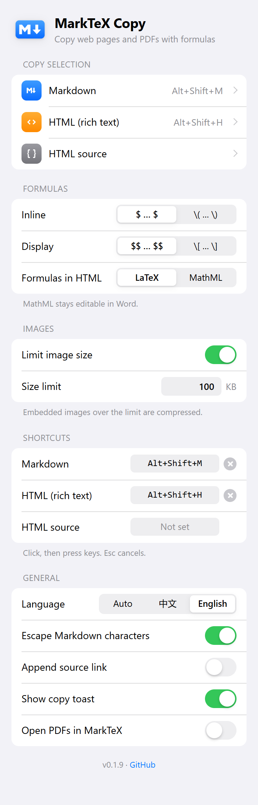
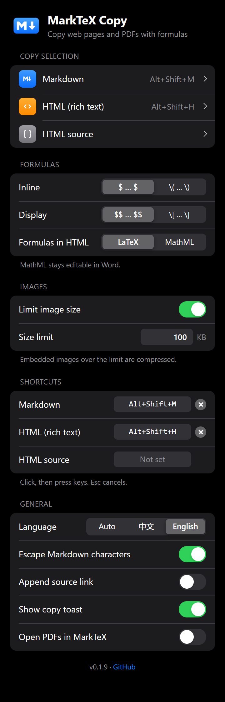

# MarkTeX Copy

[简体中文](README.md) | English

A Chrome / Edge extension that copies selections from web pages and PDFs as **Markdown** or **HTML**, keeping formulas as **LaTeX**.

  
  

## Install

1. Download the zip from [Releases](https://github.com/GetawayCar1024/marktex-copy/releases) and unzip it
2. Open `chrome://extensions` (Edge: `edge://extensions`) and turn on **Developer mode**
3. Click **Load unpacked** and choose the unzipped folder

To copy from local files (`file://`), also turn on **Allow access to file URLs** in the extension details.

## Usage

- **Context menu**: copy as Markdown / HTML (rich text) / HTML source; right-click a formula to copy just its LaTeX
- **Shortcuts**: `Alt+Shift+M` (Markdown) and `Alt+Shift+H` (HTML) by default, changeable in the popup. They only act on a selection, so `Ctrl+C` works too
- **Popup**: copy, preview, and settings such as formula delimiters, the image size limit and language

## Formulas

| Source | Typical sites |
| --- | --- |
| KaTeX | ChatGPT, Claude, DeepSeek, Notion, Luogu (HTML-only output is rebuilt from layout) |
| MathJax v2 / v3 / v4 | Stack Exchange, GitHub, blogs |
| MathML | arXiv, Wikipedia |
| `data-tex` attributes, image `alt` | Zhihu, Gemini |

Partial selections expand to whole formulas. In HTML, formulas can be LaTeX or MathML (editable in Word).

## PDF

The browser's PDF viewer doesn't let extensions read the selection, so a [PDF.js](https://github.com/mozilla/pdf.js) reader is bundled:

- PDFs still open in the browser's viewer; copying there prompts you to switch instead of copying plain text
- The reader shares the popup's style and follows the system light / dark theme; the sidebar switches between page thumbnails, the outline and more
- Copying rebuilds paragraphs, headings, nested lists, bold, code blocks, ruled tables and images (images can be selected on their own and are copied inline), and turns formulas into LaTeX: scripts, sum limits, fractions, indexed roots, math fonts (such as `\mathbb`, `\mathcal` and `\mathfrak`), accents, binomials, labeled arrows, matrices, piecewise functions and multi-line equations. Formulas in both body text and headings are recognized; they are inferred from the layout, so please check them
- PDFs exported via MathJax (e.g. Typora, where formulas are vector shapes; exported on Windows or macOS) are recognized too; TeX in outline titles (scripts, fractions, roots, `\mathbb`, `\texttt`, `\text` and more) is shown as math
- The outline follows the current section and keeps it near the middle of the sidebar (except at the start or end of the outline), including multiple sections on one page. Manually browsing the outline pauses following; the button in the corner turns following on or off
- The sidebar supports the browser's own middle-click scrolling (middle-clicking outline items or thumbnails doesn't open a new tab)
- All annotations share undo / redo buttons: `Ctrl+Z` to undo, `Ctrl+Shift+Z` or `Ctrl+Y` to redo (`⌘Z` / `⇧⌘Z` on macOS). Inputs and text currently being edited keep their own undo behavior
- Line numbers beside code blocks and samples aren't copied (including samples typeset with LaTeX listings); tables split across pages are merged; running headers / footers and content hidden at page breaks are dropped
- `Ctrl+A` selects only the PDF content and reads every page, no scrolling needed

Outline titles and page content are separate PDF data. TeX source in a bookmark does not mean the page retains that source. Copying prioritizes readable characters: letters, digits and punctuation in `\texttt` stay together, with plain text as a fallback when the font is unknown. Images and unrecognized vector glyphs are not OCRed.

## Notes

- Brackets are not backslash-escaped (`\[ \]` means math in many editors)
- CSS-styled bold, italics and headings are recognized; emphasis dots count as bold
- Code blocks without a language get one guessed from common patterns (C/C++, Python, Java, …)
- Embedded images (from PDFs, and `data:` / `blob:` images on web pages) over the size limit (100 KB by default) are compressed; other images stay links
- Doesn't work on browser pages or web stores; scanned PDFs have no text to copy

## Development checks

Run `node --test tools/test-pdf-math.cjs tools/test-pdf-navigation.cjs` to check formula reconstruction, outline positioning and undo / redo shortcuts.

With `playwright-core` and Chromium installed, run `node tools/test-pdf-reader.cjs` for real scrolling, navigation and annotation checks. `PLAYWRIGHT_MODULE` can point to an existing installation; the script generates its own test PDF.

## License

MIT. The bundled PDF.js is licensed under Apache License 2.0; `src/mathjax-glyphs.js` is generated from MathJax fonts (Apache License 2.0); the icon is based on the Markdown mark (Dustin Curtis, CC0).
