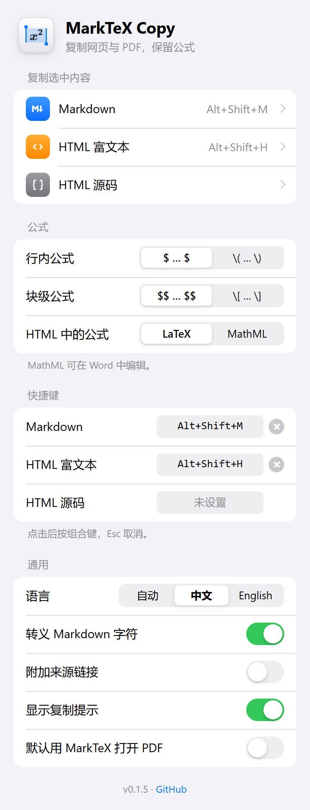
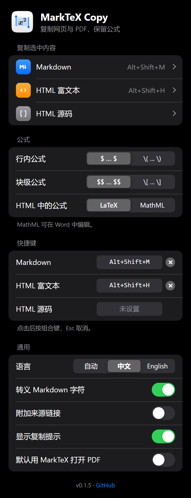

# MarkTeX Copy

简体中文 | [English](README.en.md)

Chrome / Edge 扩展：把网页和 PDF 的选中内容复制为 **Markdown** 或 **HTML**，公式保留为 **LaTeX**。

  
  

## 安装

1. 在 [Releases](https://github.com/GetawayCar1024/marktex-copy/releases) 下载 zip 并解压
2. 打开 `chrome://extensions`（Edge：`edge://extensions`），开启「开发者模式」
3. 点击「加载已解压的扩展程序」，选择解压后的目录

要复制本地文件（`file://`），还需在扩展详情页开启「允许访问文件网址」。

## 使用

- **右键菜单**：复制为 Markdown / HTML 富文本 / HTML 源码；在公式上右键可只复制它的 LaTeX
- **快捷键**：默认 `Alt+Shift+M`（Markdown）、`Alt+Shift+H`（HTML），可在弹窗中修改。仅在有选中内容时生效，也可以设为 `Ctrl+C`
- **弹窗**：复制、预览，以及公式分隔符、语言（中文 / English）等设置

## 公式

| 来源 | 典型网站 |
| --- | --- |
| KaTeX | ChatGPT、Claude、DeepSeek、Notion、洛谷（仅 HTML 输出时按排版还原） |
| MathJax v2 / v3 / v4 | Stack Exchange、GitHub、各类博客 |
| MathML | arXiv、Wikipedia |
| `data-tex` 等属性、图片 `alt` | 知乎、Gemini、掘金 |

选区只覆盖公式的一部分时会自动扩展到整个公式。HTML 中的公式可输出为 LaTeX 或 MathML（粘贴到 Word 后可编辑）。

## PDF

浏览器自带的 PDF 阅读器不允许扩展读取选区，因此扩展内置了 [PDF.js](https://github.com/mozilla/pdf.js) 阅读器：

- 默认仍用浏览器自带阅读器；在其中复制时会提示切换到 MarkTeX 阅读器，不会复制原文
- 阅读器与扩展弹窗同一风格，跟随系统浅色 / 深色；侧栏可在页面缩略图、文档大纲等之间切换
- 复制时重建段落、标题、嵌套列表、粗体、代码块、有边框的表格和图片（图片可单独选中，以内嵌图片复制），并把公式还原为 LaTeX（上下标、求和上下限、分式、根号、多行公式）。公式由排版推断，请核对
- Typora 等用 MathJax 导出的 PDF（公式是矢量图形，Windows 与 macOS 导出的都支持）也能识别出公式；大纲标题中的 TeX 会显示为公式
- 代码块和样例左侧的行号不会被复制（包括 LaTeX listings 排版的样例）；跨页的表格合并为一个；页眉页脚和跨页时被遮住的重复内容会去掉
- `Ctrl+A` 只选中 PDF 内容，并读取全部页面，无需先滚动到底

## 其他

- 不用反斜杠转义方括号（`\[ \]` 在很多编辑器里表示公式）
- 识别用 CSS 实现的粗体、斜体和标题，着重号按粗体处理；中文标点紧邻粗体时自动改用 `<strong>`
- 代码块未标注语言时，按内容推断常见语言（C/C++、Python、Java 等）
- 浏览器内置页面和扩展商店中无法使用；扫描版 PDF 没有文字可复制

## License

MIT。内置的 PDF.js 遵循 Apache License 2.0；`src/mathjax-glyphs.js` 与图标中的 x² 来自 MathJax（Apache License 2.0）的字库。
