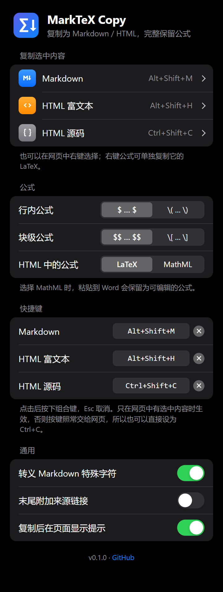

# MarkTeX Copy


一个 Chrome / Edge 扩展（Manifest V3），把网页选中内容复制为 **Markdown** 或 **HTML**，KaTeX、MathJax、MathML 公式会原样还原成 **LaTeX 源码**。

<p>
  
  
</p>

## 安装

1. 下载或 `git clone` 本仓库
2. 打开 `chrome://extensions`（Edge：`edge://extensions`），开启「开发者模式」
3. 点击「加载已解压的扩展程序」，选择仓库目录
4. 如果要在本地 `file://` 页面（例如 `test/` 下的测试页）使用，需要在扩展详情里打开「允许访问文件网址」

## 使用

| 方式 | 说明 |
| --- | --- |
| 右键菜单 | 选中内容 → 右键 →「复制为 Markdown / 复制为 HTML（富文本）/ 复制为 HTML 源码」 |
| 右键公式 | 在任意公式上右键 →「复制此处公式的 LaTeX」，不需要先选中 |
| 快捷键 | 默认 `Alt+Shift+M`（Markdown）、`Alt+Shift+H`（HTML 富文本），可在弹窗中自定义 |
| 工具栏弹窗 | 点击扩展图标：复制、预览结果、修改设置 |

三种格式：

- **Markdown**：剪贴板写入纯文本 Markdown
- **HTML 富文本**：同时写入 `text/html` 和 `text/plain`，适合粘贴到 Word、Notion、飞书、邮件等
- **HTML 源码**：把清理过的 HTML 代码当作纯文本写入剪贴板

### 自定义快捷键

在弹窗的「快捷键」一栏点击按键框，然后按下组合键（必须包含 Ctrl / Alt / ⌘ 之一，F1–F12 除外）。按 Esc 取消，点击 ⓧ 清除。

快捷键**只在网页中有选中内容时**才会触发插件复制，没有选区时按键照常交给网页。所以也可以把 Markdown 复制直接设为 `Ctrl+C`：选中内容时得到 Markdown，其余时候是浏览器原生行为。

## 公式支持

| 来源 | 识别方式 | 典型网站 |
| --- | --- | --- |
| KaTeX | `<annotation encoding="application/x-tex">` | ChatGPT、Claude、DeepSeek、Kimi、Notion、CSDN |
| MathJax v3 / v4 | 通过页面主世界脚本读取 `MathJax.startup.document` 中的原始 TeX；读不到时从辅助 MathML 反推 LaTeX | GitHub、Obsidian Publish、各类博客 |
| MathJax v2 | `<script type="math/tex">` 源码 / `MathJax.Hub.getJaxFor` | Stack Exchange、Math StackExchange |
| 原生 MathML | TeX 注释 → `alttext` → 内置 MathML→LaTeX 转换器 | arXiv HTML（LaTeXML）、Wikipedia |
| 属性 | `data-tex` / `data-latex` / `data-formula` / `data-math` | 知乎、Gemini |
| 图片公式 | `img` 的 `alt`（CodeCogs、`img.tex` / `img.latex` / `img.equation` 等） | 掘金、旧论坛 |
| Pandoc | `span.math.inline` / `span.math.display` | Pandoc 生成的页面 |

其他细节：

- 选区只框住公式的一部分时，会自动扩展到整个公式
- 自动区分行内公式和块级公式；分隔符可选 `$…$` / `\(…\)`、`$$…$$` / `\[…\]`
- HTML 中的公式可以输出为 LaTeX 文本，也可以输出为 MathML（带 LaTeX 注释），后者粘贴到 Word 时会保留为可编辑公式

## Markdown 转换细节

- 支持标题、段落、粗体、斜体、删除线、行内代码、带语言标记的代码块、链接（自动转为绝对地址）、图片（含懒加载图片）、有序和无序列表（含嵌套）、任务列表、引用、GFM 表格、分割线、上标和下标
- **用 CSS 实现的样式也能识别**：`font-weight: 600+` 识别为粗体，`font-style: italic` 识别为斜体，`line-through` 识别为删除线，`role="heading"` / `aria-level` 识别为标题（Notion、飞书、Google Docs、Tailwind 类网站常见）
- **中文粗体兼容**：`**结论：**内容` 这类结束标记紧挨中文标点的写法，按 CommonMark 规范不会被识别为粗体。插件会检测这种情况，自动改用 `<strong>…</strong>`
- **方括号不使用反斜杠转义**：`\[ \]` 在 Typora、Obsidian、MathJax 等环境里会被当作块级公式。普通文本里的 `[ ]` 原样保留；只有会构成链接语法时，以及链接文字里的方括号（例如脚注 `[1]`），才改用 `&#91;` `&#93;` 实体
- 会去掉隐藏元素、按钮（如「复制代码」）、脚本、样式和代码行号；选区完全落在代码块、链接或标题内部时，会保留外层格式

## 目录结构

```
manifest.json
background.js          右键菜单、按需注入、offscreen 兜底写剪贴板
src/settings.js        默认设置、快捷键匹配
src/capture.js         选区克隆、公式识别与 TeX 提取、CSS 样式还原、隐藏元素过滤
src/mathml2latex.js    MathML → LaTeX 转换器
src/markdown.js        HTML → Markdown / 纯文本
src/html.js            HTML 清理与公式输出
src/content.js         内容脚本：消息、快捷键、剪贴板、提示
src/main-world.js      页面主世界脚本：读取 MathJax 内部保存的 TeX
popup/                 弹窗与设置页
offscreen/             剪贴板兜底写入
icons/                 图标（make-icons.ps1 可重新生成）
test/                  KaTeX / MathJax v2 / MathJax v3 / MathML 测试页
```

## 限制

- 浏览器内置页面（`chrome://`、`edge://`、扩展商店）不允许扩展运行
- MathJax v3 页面如果把 MathJax 打包成私有模块（`window.MathJax` 不可访问），且关闭了辅助 MathML，就拿不到 TeX，这时公式保持原样
- 安装扩展前就已打开的标签页需要刷新后，快捷键和右键公式功能才能使用（右键复制与弹窗会自动注入）

## License

MIT
